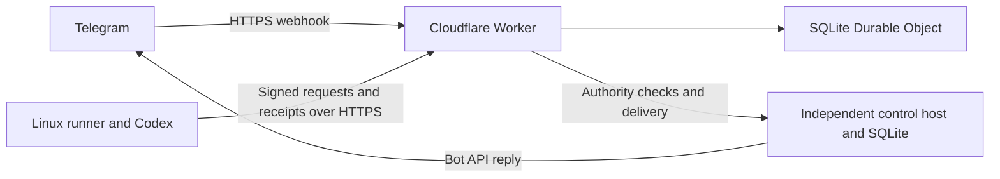

# CoconutClaw

Send a task to your Telegram bot in the private topic configured for BigFur.
The cloud gateway saves the request, an enrolled Linux runner executes it
with Codex in its assigned workspace, and the gateway returns the text reply
to the same topic. You can submit work while the runner is off, within the
deployment's admission limits.



The Worker and its SQLite Durable Object own the inbox, task ledger and
outbox. One enrolled runner polls the Worker over outbound HTTPS and owns
its local execution journal and Codex credentials. An independently
administered, always-on control host owns the current generation's authority
and the credential that sends Telegram replies.

## Use an existing BigFur deployment

1. Get the bot name, exact private topic and current admission status from
   your deployment operator. Telegram is the user interface. The operator
   handles runner startup and recovery.
2. In that topic, send a short plain-text request such as
   `Reply with a short greeting.` BigFur accepts text of up to 4 KiB from
   the configured private chat owner in that exact topic. Slash commands,
   callbacks and attachments are ignored. Each task uses a fresh, ephemeral
   Codex session.
3. Look for the reply in the same topic. If the runner is off or the reply
   is delayed, give the operator the topic and message time so they can
   identify the task in the ledger. Keep the original request for
   reconciliation and avoid submitting a duplicate.

### Queuing, cancellation and recovery

- **Offline intake.** With the webhook open and the active ledger within its
  limits, the Worker can admit and deduplicate updates when the runner and
  control host are both offline. Claiming, starting, recording runner evidence,
  cancellation and sending require active control authority. Delivery also
  requires a working Telegram route. A queued task has no execution receipt.
- **Cancellation.** Ask the operator to cancel the task through the
  authenticated `POST /v1/cancel` endpoint using the gateway task ID.
  Before a Start grant, the ledger can block launch. After a grant,
  cancellation is a request until there is signed evidence that the attempt
  never started or that the owned process exited. The Linux supervisor needs
  a fresh permit to signal running Codex and confirms exit only after reaping
  it and draining its descendants. Connectivity or authority loss can delay
  cancellation. A committed result prevails over a later cancel, and
  cancellation cannot undo effects.
- **Unknown outcomes.** Preserve the task ID, ledger, journal and signed
  evidence. An ambiguous launch or send acknowledgment can leave execution
  or delivery Unknown. Reconcile the original attempt or send with the
  operator. Exact receipt replay reports the original evidence. An Unknown
  attempt is ineligible for automatic execution retry or local fallback.
  A spent send with an Unknown outcome is held. Authorize new work only
  after checking for prior effects.

Local Miniflare and signed loopback tests verified recovery, including
offline intake, deduplication across restart, authority fencing and resume
without relaunch. The production Telegram handoff subsequently verified
replies in the existing topic and cancellation with confirmed process exit.
Intentional production outage and reconnect testing remains open.
[Gateway tests](docs/cloud-gateway-phase-1.md) ·
[Signed loopback recovery tests](docs/cloud-gateway-phase-2-local.md) ·
[Linux runner receipts](docs/gateway-linux-runner.md)

## Self-host BigFur

Use a reviewed source revision for the Worker and runner. The gateway defaults
to disabled. Production requires explicit non-preview `phase2-production`
configuration and an authorized handoff. Prepare these components before
opening ingress. [Production cutover and limits](docs/bigfur-direct-retirement.md)

- **Cloudflare.** A Workers account, HTTPS Custom Domain, SQLite `BotLedger`
  Durable Object, Worker version metadata and the pinned `cf` CLI. Building the
  Worker requires Rust with the `wasm32-unknown-unknown` target,
  `wasm-bindgen-cli` `0.2.130` and the locked npm dependencies. CI uses Node 24.
  Set `CUTOVER_TARGET` for the exact deployment, generation and object and
  `PRODUCTION_TELEGRAM_SCOPE` to `<chat-id>:<topic-id>`. Point the bot's
  webhook at `/v1/telegram` on the Custom Domain after handoff. Use distinct
  `WEBHOOK_SECRET` and `CUTOVER_CANCEL_SECRET` values.
- **Control host.** Node 24, a private SQLite database on durable local storage
  that honors locks and `fsync`, and one serving process behind HTTPS. Keep
  this service and its state outside the Worker and runner restore domains.
  Its operator verifies any predecessor's retirement, publishes the matching
  deployment and runner identity, and retains exclusive access to the Bot API
  send credential. Keep host, runner and Worker clocks aligned for the
  short-lived permits. [Control host runbook](docs/gateway-authority-control.md)
- **Signed production executor.** Build `gateway-local-executor` with the
  `local-executor` Cargo feature. Run it on Linux under a dedicated service
  account with `/usr/bin/python3` 3.10 or newer, working `pidfd_open` and
  `pidfd_send_signal`, `/proc` and Linux child subreaping. Use a service manager
  that kills the service cgroup on stop. The runner needs outbound HTTPS,
  an absolute path to native Codex, a separate private Codex home with its
  provisioned provider and authentication command, a permitted workspace and a
  durable journal. Keep the runner JSON, raw 32-byte Ed25519 seed and
  separately enrolled 64-character lowercase hex incarnation outside the
  journal, workspace and Codex home. Give the service account ownership and
  mode `0600` on each file. The single placement is `alpha`. Use
  `gateway-local-executor --production init "$RUNNER_CONFIG" "$RUNNER_JOURNAL"`
  for a new enrollment and `--production resume` with the same config and
  journal for a normal restart. The signed production path requires Linux.
  WSL operation remains unverified. macOS can run the Unix loopback fixture.
  [Runner build, configuration and recovery](docs/gateway-linux-runner.md)

Retire any predecessor poller and sender before moving the bot to the BigFur
webhook. Verify the pending-update boundary and keep the old state for
reconciliation. Production admits fresh work into a new ledger. Legacy tasks,
historical schedules and Unknown effects stay held. An ordinary cold wake
reuses the live ledger. Suspected rollback requires closing ingress and effect
authority, reconciling outstanding work and following the fresh-generation
recovery procedure. The ledger caps new tasks at 20 per UTC day, inbox
sequence at 128 and attempt IDs at 512. For supervised operation, admit at
most 16 new tasks per UTC day and close ingress when the inbox sequence
reaches 96 or the highest allocated attempt ID reaches 384. Count expired
claims toward the attempt cutoff.
[Direct retirement and recovery](docs/bigfur-direct-retirement.md) ·
[Synthetic cutover rehearsal](docs/cloud-gateway-cutover-rehearsal.md)

## Standalone polling on Linux or macOS

Use a **separate Telegram bot** from BigFur and create a private local data
directory with its own `config.toml` and SQLite state. Standalone `run` polls
Telegram, runs Codex locally by default and owns conversation history, memory,
schedules and delivery. Use one poller per bot and one runtime per data
directory. Read the migration guide before pointing it at older data.
[Migration](docs/migration-phase-0.md) · [Storage lifecycle](docs/storage-retention.md)

1. Install stable Rust/Cargo and a C toolchain for bundled SQLite, such as
   Xcode Command Line Tools on macOS. Install and authenticate Codex on the
   host that will run it. Check `codex --version` and verify it independently
   in the intended workspace. Build from the repository root.

   ```sh
   cargo build --release -p coconutclaw --locked
   BIN="$PWD/target/release/coconutclaw"
   "$BIN" --help
   ```

   Add `--offline` if the locked dependencies are cached. Adjust `BIN` if you
   use `CARGO_TARGET_DIR`. [Offline toolchain](docs/offline-toolchain.md)

2. Create a bot with **@BotFather**, send it a private message and obtain your
   numeric chat ID through your own bot administration tooling. Set `DATA`
   to your new private data directory and copy `config.toml.example` into it
   as `config.toml`. On Unix restrict the directory to mode `0700` and the
   file to `0600`. Set `TELEGRAM_BOT_TOKEN` and `TELEGRAM_CHAT_ID` in that
   file, keep `EXEC_POLICY = "safe"`, and set `CODEX_BIN` if `codex` is absent
   from your PATH. Environment settings override the file. `--data-dir`
   overrides `COCONUTCLAW_DATA_DIR` and selects the directory containing the
   config. Keep the token in private configuration. `TELEGRAM_CHAT_IDS`
   accepts additional explicitly allowed numeric chat IDs.
   [Configuration example](config.toml.example)

3. Check local setup, then start in the foreground.

   ```sh
   "$BIN" --data-dir "$DATA" doctor --json
   "$BIN" --data-dir "$DATA" run
   ```

   Inspect `codex_bin`, `telegram_token` and `telegram_chat_id` in the report.
   Doctor checks local presence and format. Verify provider and Telegram
   connectivity with the foreground run and your own bot. Send a greeting,
   then use `/start` for Home, `/tasks` for attempts and `/cancel <run-id>` in
   the originating scope. `/fresh` starts a new context while retaining
   history and memory. Stop with Ctrl+C and restart with the same data
   directory. `once` and `run` with `--inject-text` or `--inject-file` can
   invoke Codex. [Telegram operations](docs/telegram-operations.md) ·
   [Topics, rich replies and delivery](docs/topics-rich.md)

After the foreground run works, stop it before using `service install`,
`service start` and `service status` with the same `--data-dir`. The CLI
manages a systemd user service on Linux or a launchd agent on macOS. Use
`service stop` or `service uninstall` for teardown.

Standalone supports scoped memory and explicit inbox-backed one-off and
recurring schedules through `coconutclaw schedule`. Set timezone, DST and
missed-run policies when creating a schedule. `/schedules` inspects the
current chat/topic. Use `import-openclaw` to preview explicitly selected
Markdown files and `--apply` to import scoped candidates.
[Memory](docs/memory.md) · [Scheduling](docs/inbox-scheduling.md#entry-points) ·
[Import contract](docs/openclaw-import.md) · [Provider timeouts](docs/provider-timeouts.md)

## Paired runners, desktop and Windows

The standalone coordinator can route new text tasks in a chat/topic to a
trusted native runner. Use matching committed revisions, fixed reachable UDP
addresses in both directions, host-local Codex authentication and a dedicated
workspace. Enroll and pair by exchanging reviewed public cards. Start the
runner with `coconutclaw --data-dir "$RUNNER_DATA" nodes start`, then select it
under **Home → Nodes** for future tasks. The coordinator polls Telegram,
owns cancellation and reconciliation, and delivers results.
[Pairing and recovery](docs/production-nodes.md) ·
[Fleet verification](docs/fleet-verification.md) ·
[Historical multihost fixture](docs/multihost-acceptance.md)

- **Native Windows build.** With native Rust and a C linker installed, run
  this from the repository root in PowerShell.

  ```powershell
  cargo build --release --locked -p coconutclaw --bin coconutclaw
  $Bin = Join-Path $PWD 'target\release\coconutclaw.exe'
  ```

  Use the Windows CLI for the foreground paired runner or to launch the
  desktop companion as described below. Standalone Telegram coordinator
  operation on Windows remains unverified. BigFur's signed production
  executor requires Linux.
- **Native Windows paired runner.** Follow the PowerShell guide to enroll a
  private ACL-protected root and pair with the coordinator. Start with
  `& $Bin --data-dir $RunnerData nodes start`, wait
  for `Runner ready`, and use `nodes status` from another terminal. Ctrl+C
  stops the foreground runner. Restart with the same root. Windows uses Job
  Objects for owned descendants. The CI workflow requires native custody, ACL,
  pairing and restart tests. Dated fleet receipts cover earlier revisions.
  Windows service management is unavailable through `coconutclaw service`.
  [Native Windows PowerShell guide](docs/windows-onboarding.md)
- **Desktop companion.** Open the packaged app directly for its synthetic
  demo or a read-only coordinator snapshot exported with
  `coconutclaw desktop --database "$COORDINATOR_DB" --session "$SESSION"`.
  For local pairing and runner controls, launch under the enrolled account
  with `coconutclaw --data-dir "$RUNNER_DATA" desktop-host --companion "$COMPANION"`.
  The packaged Linux GTK app exercised those controls. On Windows, keep the
  portable companion EXE beside its `nsh` directory. The documented PowerShell
  host invocation is `& $Bin --data-dir $RunnerData desktop-host --companion $Companion`.
  Native Windows package, UI and runner-control acceptance remain open.
  [Desktop startup and rollout gates](docs/desktop/README.md) ·
  [Package validation](docs/desktop/validation.md)

## Local verification

```sh
cargo fmt --all -- --check
cargo clippy --workspace --all-targets --locked -- -D warnings
cargo build -p coconutclaw --bin coconutclaw --locked
cargo test --workspace --all-targets --locked
```

Build the normal CLI before the native lifecycle tests. Workspace tests use
fake Telegram endpoints and fake Codex executables. CI runs native checks on
Linux, macOS and Windows. Its Ubuntu gateway job exercises local fixture
phases and validates the disabled Worker bundle with a `cf` dry run.
The signed Linux executor and optional installed-Codex loopback checks
have their own fixture instructions. The verification records identify
the revision and environment used for hosted and live acceptance.
[CI workflow](.github/workflows/ci.yml) ·
[Gateway loopback tests](docs/cloud-gateway-phase-2-local.md) ·
[Linux runner tests](docs/gateway-linux-runner.md) ·
[Architecture](docs/architecture.md) ·
[Phase 0 validation](docs/validation-phase-0.md)
